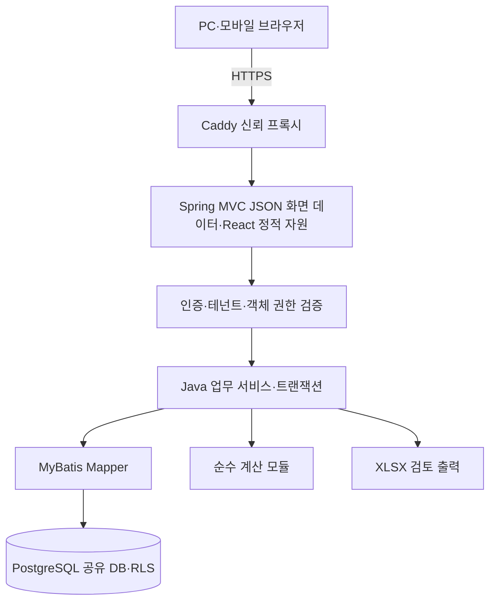

# 시스템 아키텍처

> 2026-10-26 후속 결정: 사용자가 기존 전체 화면의 React 전환을 승인했다. 현재 표현 계층은 [ADR-0003](../adr/0003-react-frontend.md)과 [React 전환 계약](../superpowers/specs/2026-10-26-react-full-migration.md)을 따른다. 아래 Phase3의 Thymeleaf·htmx 선택은 결정 이력이며, 모듈·업무·테넌트 경계는 유지한다.

## 1. 상태와 범위

- 기준일: 2026-10-24, Phase 3 설계 결정. 구현·실행 검증 완료를 뜻하지 않는다.
- 제품 범위는 [PRD](../prd.md), 상태 전이는 [승인 규칙](../rules/workflow.md), 시간 계산은 [계산 규칙](../rules/calculation.md)을 따른다.
- 여러 고정 근무 템플릿, 사원별 적용일, 당일 한 근무 구간, IP 출퇴근, 1단계 승인, 종일 연차, 일반 검토용 XLSX를 지원하도록 설계한다.
- QR·추가 근무 신청·월 마감 잠금·PWA·반차·시간 휴가·연차 자동 발생·급여 매핑은 후속이다. 실제 추가 근로 의심 기록과 과거 변경·재집계는 보존한다.
- 이 문서는 구조와 인터페이스를 정의한다. 소스·DDL·SQL·환경 설정과 프로젝트 골격을 생성하지 않는다.

## 2. 대안과 채택

| 대안 | 장점 | 비용 | 결정 |
| --- | --- | --- | --- |
| 업무별 모듈형 모놀리스 + SSR | 한 배포·트랜잭션으로 운영하고 원장·승인 정합성 확보 | 모듈 의존성 규율 필요 | 채택 |
| SPA + 별도 API | 풍부한 클라이언트 상호작용 | 인증·화면 상태·빌드·배포 부담 증가 | MVP 제외 |
| 업무별 마이크로서비스 | 독립 배포 | 분산 승인·원장·재집계와 운영 복잡성 | 초기 제외 |

Thymeleaf 서버 렌더링을 기본으로 하고 htmx는 목록·검증·처리 결과의 부분 갱신에 한정한다. JavaScript가 비활성화되어도 핵심 폼 제출·목록 조회가 가능하도록 설계한다. htmx의 HTML 응답 방식은 [공식 문서](https://htmx.org/docs/)를 참고했다. 세부 버전과 통합 검증 조건은 [ADR-0001](../adr/0001-technology-baseline.md)을 따른다.

## 3. 구성과 배포 경계

단일 애플리케이션·공유 DB가 기준이다. Caddy 이외에서 백엔드로 직접 접근할 수 없도록 운영 경계를 설계한다. 인스턴스 수·VPS 사양·목표 처리량·백업 복구 목표는 실측 전 확정하지 않는다. 세션·인증 정보의 프로세스 의존성은 Phase 4 착수 후 재시작·복수 인스턴스 요구와 함께 검증한다.

## 4. 업무 모듈과 소유권

| 모듈 | 소유 데이터·역할 | 공개 업무 인터페이스 | 의존 |
| --- | --- | --- | --- |
| tenant / identity | 고객사 상태, 고객사 계정·초대·역할, 운영자 계정 분리 | 인증된 업무 범위 발급·회수 | 감사 |
| people | 조직·사원·재직 이력 | 기준일 사원 상태·조직 조회 | identity |
| schedule | 고정 템플릿·배정·휴일·정책 버전 | 사원·근무일의 유효 일정 조회 | people |
| attendance | 원천 출퇴근·중복 방지·일별 입력 개정 | 본인 기록 등록, 승인 정정 효과 적용 | schedule, identity |
| workflow | 신청·지정 승인자·대체 지정·결정 이력 | 제출·철회·승인·반려·승인 취소 요청 | people, identity |
| leave | 기초 잔여 묶음·조정·사용·복원 원장 | 승인 가능량 검증과 원장 반영 | schedule, workflow |
| calculation | 불변 입력으로 계산·예외 판정, 결과 버전 | 일 계산, 주·월 합산 | 규칙·일정·유효 입력의 값 객체 |
| reporting | 권한 범위의 일·주·월 현황·XLSX | 결과와 근거 조회·일관된 출력 | calculation, identity |
| audit | 변경 주체·사유·접근·출력 이력 | 감사 사건 추가·허용 범위 조회 | 공통 메타데이터 |

컨트롤러가 Mapper를 직접 호출하지 않는다. 모듈 간 다른 모듈의 테이블을 임의 수정하지 않으며 Java 서비스 인터페이스로 명령을 전달한다. 조회 조인은 보고용 Mapper에 모으되 모든 테넌트 조건·객체 범위를 검토한다. 핵심 업무 규칙은 Java에 두고 DB에는 제약·원자성·RLS를 둔다. 별도 모듈 프레임워크와 메시지 브로커는 추가하지 않는다.

위 표는 업무 책임 경계이며 새 패키지10개를 확정한 목록이 아니다. kickoff의 `common/org/schedule/clock/request/leave/worktime/console` 패키지 초안을 유지한다. identity·tenant 범위 검증·audit 공통 기반은 `common`, 고객사·people은 `org`, attendance는 `clock`, workflow는 `request`, calculation·보고 계산 조회는 `worktime`, SaaS 운영자 콘솔은 `console`에 매핑한다. 근태 담당자 화면은 해당 업무 도메인의 권한을 사용하며 `schedule/leave`는 같은 이름의 도메인을 소유한다. 실제 패키지 생성은 Phase4의 별도 요청 후에만 한다.

## 5. 공통 요청 계약

1. 세션에서 고객사·사원·역할과 권한 개정을 확인하고, 대상 객체에 허용된 범위를 결정한다.
2. 입력 형식·CSRF·재직 상태·고객사 이용 상태를 검증한다. IP 검증은 출퇴근 명령에 적용한다.
3. Java 서비스가 트랜잭션을 열고 같은 커넥션에 트랜잭션 로컬 테넌트 컨텍스트를 설정한다.
4. 대상 행·현재 버전·권한을 다시 확인하고 업무 상태·효과·감사 이력을 함께 반영한다.
5. 커밋된 결과만 성공으로 표시한다. 응답은 HTML 전체 또는 동일 의미의 부분 HTML이다.
6. 실패 시 전체 롤백하고 풀 반환 전 컨텍스트 잔존 여부를 검증한다. 세부 보안은 [보안 설계](security.md)를 따른다.

조회·집계·XLSX도 인증 범위가 있는 명시적 트랜잭션을 사용한다. URL의 사원 ID·신청 ID와 브라우저의 `tenant_id`·IP·시각·차감량·승인자 권한은 신뢰하지 않는다. 화면·요청·응답의 구체 계약은 [화면과 HTTP 계약](screens.md)에 정의한다.

## 6. 원자성과 동시 요청

| 명령 | 같은 트랜잭션에서 보장할 효과 | 경합 제어 |
| --- | --- | --- |
| 출퇴근 | 서버 수신 시각 원천 + 중복 키 + 입력 개정 + 감사 | 명령 키 유일성, 사원·근무일 직렬화로 유효 중복 차단 |
| 신청 제출 | 불변 신청 내용 + 현재 승인자 + 최초 이력, 정정 대기는 검토 개정·재집계 필요만 변경 | 중복 키, 중복 대상 기간 검증 |
| 근로·휴게 확인 | 확인 증거 + 검토 개정 + 재집계 필요, 사실 입력 개정은 유지 | baseInputRevision·현재 검토 개정 검증 |
| 연차 승인 | PENDING 판정 + 날짜별 잔여 재검증 + 단일 묶음 차감 + 승인 이력 + 입력 개정·재집계 필요 | 신청 버전·사원 연차 잔여 잠금, 날짜 순 고정 잠금 순서 |
| 정정 승인 | 승인 결정 + 현재 입력을 대체하는 연결 정정 효과 + 입력 개정·재집계 필요 | 근무일 입력 버전 재검증, 오래된 정정은 충돌 안내 |
| 연차 승인 취소 | 별도 취소 요청 승인 + 원효과 무효화 + 원장 역분개 + 입력 개정·재집계 필요 | 원승인·취소 효과 유일성, 한 번만 복원 |
| 대체 승인자 지정 | 권한·자기 승인 검증 + 대기 신청 재할당 + 이력 | 처리 결정과 재할당이 같은 신청 버전 경합 |

락은 필요한 사원·날짜·연차 묶음·신청 행에 한정하고 같은 순서로 획득하는 규약을 구현 시 확정한다. 데드락·직렬화 실패는 전체 명령만 제한적으로 재시도하고 중간 효과를 재실행하지 않는다. 동일 명령 키·동일 입력은 기존 처리 결과, 동일 키·다른 입력은 충돌로 응답한다. 키 없이도 하루 한 유효 출근·퇴근의 업무 중복 조건을 검사한다.

승인 후 원신청은 APPROVED 이력으로 남는다. 연차의 현재 업무 효과 EFFECTIVE/CANCELED를 별도로 표시하며 취소 심사 중에는 원승인 효과가 유지된다. 승인된 출퇴근 정정은 취소하지 않고 현재 유효 입력을 참조하는 새 정정으로만 바꾼다. 새 정정이 승인되면 이전 정정 효과는 SUPERSEDED로 추적한다. 반려 뒤 재신청은 원신청에 연결된 새 신청이다. 자기 승인 금지는 역할 겸임·대체 지정·담당자 작성 요청의 대상자/작성자 모두에 적용한다.

## 7. 계산·재집계와 일관된 출력

- `input_revision`은 출퇴근·일정·승인 효력 등 사실 입력의 개정이다. `review_revision`은 대기 정정·직원 근로/휴게 확인 등 검토 증거의 개정이며 둘을 분리한다.
- 대기 정정 제출·철회·반려와 확인 증거 저장은 사실 입력을 바꾸지 않는다. 검토 개정과 재집계 필요만 올리므로 방금 확인한 사실을 자기 변경으로 오래된 입력 처리하지 않는다.
- 확인 증거의 `confirmed_input_revision`·정정의 `baseInputRevision`은 사실 개정과 대조한다. 승인 정정에 실제 구간 증거가 포함되면 승인 후 새 사실 개정에 결속한다.
- 입력 스냅샷은 원천 기록 ID, 유효 정정·휴가 효과, 일정·휴일·정책 버전, 사원·근무일 사실/검토 개정 쌍, 규칙 버전을 포함한다.
- 순수 계산은 네트워크·DB·현재 시각을 직접 읽지 않는다. 동일 입력·규칙 버전은 동일 결과를 만든다.
- 계산 결과는 새 버전으로 추가한다. 확정 불가 값은 `null`과 사유를 가지며, 0시간 정상 결과와 구분한다.
- 실제 근로·휴게에 영향을 주는 대기 정정은 미해결 검토 자료로 계산에 전달한다. 원승인 효력은 유지하면서 현재 정상 확정은 보류하고 이전 산정값은 참고 이력으로 구분한다.
- 계산 중 사실/검토 개정 중 하나가 바뀌면 결과를 최신으로 채택하지 않는다. 재시도하거나 기존 결과에 `STALE`을 표시한다.
- 일·주·월은 원래 정수 밀리초를 합산하고 표시 단계에서만 시·분·초로 변환한다. 법령 판정과 제품 집계 경계는 계산 규칙을 따른다.
- MVP에서는 요청 단위 동기 계산과 대상 제한 재집계를 기본으로 한다. 실패한 계산은 원천·승인을 되돌리지 않고 재계산 필요 상태로 노출한다.
- 승인·정정·연차 취소와 재집계 필요 표시는 원자적으로 커밋한다. 실제 계산·XLSX 생성은 승인 트랜잭션 밖에서 수행하며 DB 효과 실패는 승인 전체를 롤백한다.
- 보고서는 읽기 시점의 결과 ID·개정·필터·상태를 고정한다. XLSX 생성 도중 입력이 변해도 서로 다른 버전을 섞지 않는다.
- 월 마감 잠금은 없다. 과거 정정·승인 취소도 이유·고객사 승인·새 결과 버전과 함께 처리한다.
- 대규모 작업 큐·비동기 계산은 부하 측정 후 도입한다. 도입 시 작업마다 명시적인 테넌트·요청자 범위·입력 버전을 보존한다.

## 8. 실패 처리와 검증 계획

업무 상태 경합·잔여 부족·오래된 입력은 재조회 가능한 업무 오류로, DB·내보내기 실패는 요청 식별자와 재시도 안내로 보여 준다. 미저장 상태를 완료로 표시하거나 네트워크 실패 때 브라우저 시각을 소급 기록하지 않는다. 출퇴근 실패는 내역 확인 후 필요한 정정 신청으로 연결한다.

구현 순서는 스키마·HTTP 계약 검토 → 계산·상태 전이 기대값 테스트 → 서비스·Mapper 구현 → 실제 PostgreSQL 격리·경합 검증이다. 검증 대상은 테넌트 CRUD·출력 격리, 승인/철회/재할당 경합, 잔여 부족 동시 승인, 취소 역분개 중복, 자정·월·연도 경계, 오래된 계산, XLSX 버전 혼합이다. 추가 회귀 기준은 확인 저장·정정 제출 후 사실 개정 유지, 사실 변경 후 기존 확인 무효화, 검토 개정만 바뀐 계산의 오래됨 검출이다. 현재는 문서 검증만 수행하며 애플리케이션·DB·부하 테스트는 수행하지 않는다.
