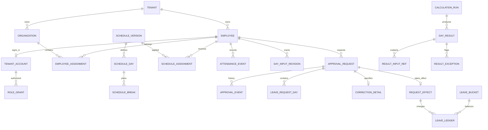

# 개념·논리 데이터 모델

> 2026-10-28 코드 확장: V14의 공통코드 그룹/상세·근태유형/불변 정책 버전과 신청의 `attendance_type_version_id` 복합 FK는 아래 [4단계 모델](#10-공통코드근태유형-4단계-물리-모델)·[상세 계약](code-management.md)을 따른다. 기존 신청은 실제 고정 종류에 해당하는 기초 버전 참조만 보강하고 기존 열·결정·효력·원장을 유지한다. 실제 V13→V14 자료 보존·기본 DB 반영·복원 결과는 [4단계 보고서](../quality/code-management.md)로 구분한다.

> 2026-10-28 결재선 확장: V13의 정의·불변 버전·적용일 배정·신청별 스냅샷과 기존 신청 참조 XOR/지연 FK 계약은 [결재선 상세](approval-routes.md#v13과-db-경계)를 따른다. 기존 신청·결정·원장 행을 변환하지 않는다. 실제 마이그레이션·검증 범위는 [3단계 보고서](../quality/approval-routes.md)에 기록하며, 아래 최초 논리 설계의 미실행 표기는 당시 상태다.

## 1. 모델 상태와 공통 표기

기준일은 2026-10-24다. [PRD](../prd.md), [승인 규칙](../rules/workflow.md), [계산 규칙](../rules/calculation.md)을 구현 가능한 계약으로 연결하는 논리 설계다. 실제 테이블·DDL·SQL·마이그레이션은 생성하지 않는다. 물리 인덱스·보존 기간·암호화 키 정책은 Phase 4 착수 시 별도 검증한다.

- `id`: UUID. 별도 키를 명시한 잔액 투영을 제외한 업무 엔티티의 PK는 `(tenant_id, id)`, 전역 엔티티는 `id`다. Tenant·PlatformOperator·PlatformAuditEvent는 전역 메타데이터다.
- 모든 고객사 행은 `tenant_id UUID NOT NULL`이며 부모 참조는 `(tenant_id, parent_id)` 복합 FK다. UUID 단독 FK로 타 고객사 연결을 허용하지 않는다.
- 표의 `?`는 NULL 허용, 표기 없는 필드는 NOT NULL이다. PK·FK·유일성은 논리 제약이며 실행된 DB 제약이 아니다.
- `enum`은 허용값이 정해진 논리 도메인이다. PostgreSQL enum 타입을 물리적으로 생성하라는 결정은 아니다.
- 공통 생성 필드: `created_at timestamptz(3)`, `created_by UUID`; 생성 주체 종류는 계정·운영자·시스템을 구분한다. 고객사 내 주체 참조와 운영자 참조를 한 FK로 혼합하지 않는다.
- 변경 가능한 현재 상태에는 `version bigint`, `updated_at timestamptz(3)`를 둔다. 원천·원장·결정 이력은 추가만 하며 현재 상태 투영과 구분한다.
- 실제 시각은 UTC instant 의미의 `timestamptz(3)`, 근무일·적용일은 `date`, 일정 시각은 `time(3)`와 `Asia/Seoul`이다. `timestamptz`가 원래 시간대 이름을 보존한다고 가정하지 않는다.
- 계산량은 `duration_millis bigint` 정수다. 밀리초보다 세밀한 입력은 경계에서 거부하며 묵시적으로 반올림하지 않는다. 화면 표시와 주·월 합계는 원래 밀리초를 유지한다.
- 종일 연차는 `quantity_days integer`, 단위 `DAY`만 사용한다. 시간으로 환산하여 법정 근로시간에 합산하지 않는다.
- 적용 구간은 `[valid_from, valid_to)`이고 종료일 NULL은 계속 유효를 뜻한다. 같은 사원·같은 설정 종류의 적용 구간 중첩을 차단한다.

## 2. 주요 관계

ERD는 주요 관계만 표시한다. 신청 한 건의 날짜별 휴가 상세는 여러 행이며, 정정 신청과 휴가 신청은 요청 종류에 맞는 상세만 갖는다. 아래 필드·제약을 우선한다. 모든 연결에는 표에 생략된 테넌트 FK가 포함된다.

## 3. 고객사·계정·재직·권한

| 엔티티 | 핵심 필드·타입 | 유일성·참조·불변 조건 |
| --- | --- | --- |
| Tenant | `id UUID`, `company_code varchar(80)`, `name varchar(120)`, `status enum`, `timezone varchar(40)` | company_code 전역 유일, timezone=Asia/Seoul, 상태 변경 감사 |
| PlatformOperator | `id UUID`, `login_id varchar(254)`, `password_hash text`, `status enum`, `auth_version bigint` | 운영자 전용 로그인·권한. TenantAccount와 독립, 고객사 데이터 FK 없음 |
| Organization | `id UUID`, `code varchar(40)`, `name varchar(120)`, `parent_id UUID?`, `active boolean` | 고객사 내 code 유일, 부모 같은 고객사, 순환·자기 부모 금지 |
| Employee | `id UUID`, `employee_no varchar(40)`, `display_name varchar(120)`, `joined_on date`, `left_on date?`, `status enum` | 고객사 내 employee_no 유일, 사번 재사용 금지, joined_on~left_on은 재직 첫날/마지막 날 포함 |
| EmployeeAssignment | `id UUID`, `employee_id UUID`, `organization_id UUID`, `valid_from date`, `valid_to date?`, `reason text` | 사원·적용 구간 중첩 금지. 과거 소속 보존 |
| EmploymentRuleAssessment | `id UUID`, `employee_id UUID`, `category enum`, `reviewed_by UUID`, `reviewed_on date`, `basis text`, `valid_from date`, `valid_to date?` | 성인 통상 일반규정 검토 완료/별도 검토 대상/미확인 구분. 민감한 보호 사유 원문은 최소 수집 |
| TenantAccount | `id UUID`, `employee_id UUID`, `login_email varchar(254)`, `password_hash text?`, `status enum`, `auth_version bigint` | 고객사 내 정규화 login_email·employee_id 각각 유일. 초대 전·미수락 상태만 비밀번호 NULL |
| RoleGrant | `id UUID`, `account_id UUID`, `role enum`, `scope_kind enum`, `organization_id UUID?`, `valid_from timestamptz`, `valid_to timestamptz?`, `reason text` | EMPLOYEE=본인, APPROVER=지정 대상, ATTENDANCE_ADMIN=고객사 범위. 역할별 범위 검증 |
| AccountToken | `id UUID`, `account_id UUID`, `purpose enum`, `token_hash text`, `expires_at timestamptz`, `used_at timestamptz?` | token_hash 유일, INVITE/RESET 구분, 계정·tenant·목적 결속, 일회성 소비 |
| ApproverAssignment | `id UUID`, `employee_id UUID`, `approver_employee_id UUID`, `valid_from date`, `valid_to date?`, `reason text` | 같은 고객사, 자기 지정 금지, 사원별 유효 1단계 승인자 한 명 |

로그인은 회사 코드 + 고객사 내 계정으로 단순화한다. 같은 이메일의 다른 회사 계정은 별도 자격·권한이며 자동 연결하지 않는다. 다중 고객사 전환 UI와 전역 사용자 통합은 후속이다. 운영자의 최초 고객사·담당자 연결은 감사 가능한 온보딩 명령으로만 수행하며 고객사 업무 승인을 부여하지 않는다.

## 4. 일정·휴일·적용 정책

| 엔티티 | 핵심 필드·타입 | 제약·의미 |
| --- | --- | --- |
| ScheduleTemplate | `id UUID`, `code varchar(40)`, `name varchar(120)`, `active boolean` | 고객사 내 code 유일. 비활성화도 과거 버전을 보존 |
| ScheduleVersion | `id UUID`, `template_id UUID`, `revision integer`, `valid_from date`, `valid_to date?`, `reason text` | template+revision 유일, 버전 내용 불변 |
| ScheduleDay | `id UUID`, `schedule_version_id UUID`, `weekday integer`, `is_workday boolean`, `start_time time?`, `end_time time?` | version+weekday 유일, 근로일이면 시작<종료, 비근로일은 시각 NULL |
| ScheduleBreak | `id UUID`, `schedule_day_id UUID`, `sequence integer`, `start_time time`, `end_time time` | day+sequence 유일, 예정 휴게끼리 중첩 금지·일정 범위 내. 실제 휴게 증빙과 구분 |
| ScheduleAssignment | `id UUID`, `employee_id UUID`, `schedule_version_id UUID`, `valid_from date`, `valid_to date?`, `reason text` | 사원별 구간 중첩 금지, 배정 적용일과 버전 유효일 검증 |
| CalendarVersion | `id UUID`, `revision integer`, `valid_from date`, `valid_to date?`, `reason text` | 고객사 내 revision 유일, 변경은 새 버전 |
| CalendarDay | `id UUID`, `calendar_version_id UUID`, `date date`, `day_kind enum`, `name varchar(120)`, `basis text` | calendar+date 유일. 공휴일·회사휴일·주휴 관련 근거를 구분 |
| WorkPolicyVersion | `id UUID`, `revision integer`, `valid_from date`, `valid_to date?`, `rule_version varchar(80)`, `basis text`, `definition structured value` | 고객사 정책·제품 규칙 버전 분리, 적용일·규칙의 의미는 계산 규칙 참조 |
| AllowedNetwork | `id UUID`, `network cidr`, `label varchar(120)`, `valid_from timestamptz`, `valid_to timestamptz?`, `reason text` | IPv4/6 정규화, 광범위 허용 경고·중복 검사, 변경 감사 |

정책의 `definition`은 명세에 정의된 필드만 허용하는 논리 값 객체다. 자유 스크립트·표현식 엔진을 만들지 않는다. 날짜별 유효 일정·휴일·정책을 계산 입력 참조에 고정하며 과거 변경도 이전 버전을 교체하지 않는다.

## 5. 원천 출퇴근·유효 입력

| 엔티티 | 핵심 필드·타입 | 제약·의미 |
| --- | --- | --- |
| AttendanceEvent | `id UUID`, `employee_id UUID`, `event_kind enum`, `occurred_at timestamptz(3)`, `received_at timestamptz(3)`, `client_command_id UUID`, `source enum`, `validated_ip inet`, `network_id UUID`, `assigned_work_date date?` | 사원+명령 키 유일. 직접 기록은 서버 시각. 미분류 근무일 NULL 가능, 자정·복수 구간도 삭제 금지 |
| DayInputRevision | `id UUID`, `employee_id UUID`, `work_date date`, `input_revision bigint`, `review_revision bigint`, `recalculation_required boolean`, `last_calculated_input_revision bigint?`, `last_calculated_review_revision bigint?`, `reason_ref UUID`, `reason_kind enum` | employee+work_date 유일 현재 개정. 사실·검토 개정 분리, 승인 효과·재집계 필요 원자적 반영 |
| EffectiveAttendance | `id UUID`, `employee_id UUID`, `work_date date`, `input_revision bigint`, `review_revision bigint`, `in_at timestamptz?`, `out_at timestamptz?`, `break_evidence enum`, `source_refs structured list` | 사원+근무일+개정 쌍 유일. 원천·승인 정정·유효 확인으로 재현되는 불변 스냅샷 |
| WorkConfirmation | `id UUID`, `employee_id UUID`, `work_date date`, `confirmed_input_revision bigint`, `review_revision bigint`, `confirmed_at timestamptz`, `confirmed_by_account_id UUID`, `presence_as_work boolean`, `break_snapshot structured list`, `source_refs structured list` | 본인 퇴근 후 사실 개정에 결속한 근로·휴게 확인. 저장은 검토 개정만 증가, 자기 생성 충돌 없음 |
| BreakEvidence | `id UUID`, `employee_id UUID`, `work_date date`, `start_at timestamptz`, `end_at timestamptz`, `confirmed_input_revision bigint`, `review_revision bigint`, `confirmed_by_account_id UUID`, `confirmed_at timestamptz`, `basis_kind enum`, `approved_request_id UUID?` | 실제 확인 구간. 예정 휴게 자동 생성 금지, 승인 정정 증거는 승인 후 새 사실 개정에 결속 |

직접 출퇴근 명령의 브라우저 시각은 발생 시각으로 채택하지 않는다. 직원이 퇴근 후 실제 근로·예정 휴게 일치를 명시적으로 확인한 경우에만 해당 사실 개정의 확인 증거를 만든다. 출퇴근·일정·승인 정정 등 사실 입력이 바뀌면 기존 확인을 자동 재사용하지 않고 REVIEW_REQUIRED로 재확인한다. 정정 제출·확인 저장은 사실 개정을 올리지 않으며 검토 개정·재집계 필요만 올린다. 승인 정정이 새 실제 구간 증거를 포함하면 새 사실 개정에 증거를 결속한다. 누락 시각·일정 밖 시각·실제 휴게 차이는 정정 명세를 통해 고객사 승인으로 반영한다. IP 원문을 일반 감사 로그·XLSX에 복제하지 않으며 검증된 증빙 필드의 보존·열람은 보안 설계를 따른다.

## 6. 신청·결정·효과

| 엔티티 | 핵심 필드·타입 | 제약·의미 |
| --- | --- | --- |
| ApprovalRequest | `id UUID`, `target_employee_id UUID`, `author_account_id UUID`, `kind enum`, `status enum`, `current_approver_id UUID`, `approver_assignment_id UUID`, `approver_assignment_version bigint`, `submitted_at timestamptz`, `reason text`, `predecessor_request_id UUID?`, `original_request_id UUID?`, `leave_bucket_id UUID?`, `client_command_id UUID`, `version bigint` | 작성자+명령 키 유일. 대상/승인자→Employee·작성자→TenantAccount. 원문 불변, 연차는 단일 bucket·취소는 original 필수 |
| LeaveRequestDay | `id UUID`, `request_id UUID`, `leave_date date`, `quantity_days integer`, `schedule_version_id UUID`, `calendar_version_id UUID` | request+date 유일, 0 또는1 DAY, 합계0 거부. 승인 직전 현재 입력과 다시 대조 |
| CorrectionDetail | `id UUID`, `request_id UUID`, `work_date date`, `base_input_revision bigint`, `in_action enum`, `out_action enum`, `requested_in_at timestamptz?`, `requested_out_at timestamptz?`, `requested_breaks structured list`, `before_snapshot structured value` | request 유일, KEEP/SET/CLEAR로 미변경·값 지정·유효 값 제외 구분. SET만 시각 필수, 최소 한 항목 정정·원천 삭제 없음 |
| ApprovalEvent | `id UUID`, `request_id UUID`, `event_kind enum`, `actor_account_id UUID`, `from_status enum?`, `to_status enum?`, `reason text`, `previous_approver_id UUID?`, `new_approver_id UUID?`, `at timestamptz` | 결정·철회·재할당 이력 불변. 신청당 최종 결정 한 번, 대체 지정 전후 주체 보존 |
| RequestEffect | `id UUID`, `request_id UUID`, `effect_kind enum`, `effective_at timestamptz`, `validated_input_refs structured list`, `reverses_effect_id UUID?`, `supersedes_effect_id UUID?` | request+effect_kind 유일, 승인 시 재검증 근거 보존. 역효과·대체 참조 각각 유일 |

종류는 LEAVE_DAY, ATTENDANCE_CORRECTION, CANCEL_LEAVE로 한정한다. 추가 근무 신청·정정 취소 종류는 만들지 않는다. 원본 APPROVED 상태와 별개로 연차 효과는 EFFECTIVE/CANCELED, 정정 효과는 EFFECTIVE/SUPERSEDED로 판정한다. 연차 취소 심사 중 원효과는 유효하며 반려·철회는 효과를 만들지 않는다. 같은 사원·근무일의 대기 정정은 최대1건, 현재 유효 승인 정정도 최대1건이다. 새 정정 승인 시 기존 효과를 대체하며, 과거 정정을 취소하여 임의 이전 상태로 복원하지 않는다.

대체 지정은 담당자가 권한·재직·자기 승인 금지를 검증해 대기 요청만 재할당한다. 이미 처리한 결정은 바꾸지 않는다. 과거·퇴사자 예외 요청은 담당자가 대상·사실·근거를 검토해 작성하고 대상자와 작성자 모두와 다른 승인자가 심사한다. 서비스 운영자의 승인 우회는 없다.

## 7. 종일 연차 원장

| 엔티티 | 핵심 필드·타입 | 제약·의미 |
| --- | --- | --- |
| LeaveBucket | `id UUID`, `employee_id UUID`, `base_date date`, `usable_from date`, `usable_to date?`, `source_reference text`, `created_by_account_id UUID` | usable_from/usable_to 양 끝 포함, NULL 종료는 기한 미지정. 근거·가능 구간 보존, 자동 발생/소멸 없음 |
| LeaveLedger | `id UUID`, `bucket_id UUID`, `employee_id UUID`, `entry_kind enum`, `signed_quantity_days integer`, `effective_on date`, `request_effect_id UUID?`, `leave_date date?`, `reverses_entry_id UUID?`, `reason text` | OPENING/ADJUSTMENT/USE/RESTORE, 역분개 원행 유일. 사용·복원은 효과·날짜 참조 필수 |
| LeaveBalance | `employee_id UUID`, `bucket_id UUID`, `quantity_days integer`, `version bigint` | employee+bucket 유일 잠금·조회 투영. 원장 합과 일치해야 하며 독립 수정 금지 |

기초 수량도 원장 OPENING으로 기록한다. 조정은 담당자·근거·기준일을 기록하고 현재 유효 승인 사용분을 훼손하는 음수 잔여는 거부한다. 담당자 자신의 기초 등록·증감은 다른 담당자만 수행한다. 특정 법정 발생량으로 간주하지 않는다. 기준일 이전 사용을 다시 차감하지 않으며 소급 건은 검토한다. 사용 가능일이 지난 묶음은 신규 날짜에 사용할 수 없지만 원장 잔액을 자동 소멸시키지 않는다.

대기량은 별도 신청 조회로 계산하며 예약 원장을 만들지 않는다. 신청은 전체 선택 기간에 유효한 단일 `leave_bucket_id`를 명시한다. 여러 후보면 사용 종료일이 빠른 묶음을 우선 제안하되 자동 혼합 배분하지 않는다. 묶음 경계를 넘는 기간은 분리 신청한다. 같은 묶음 유효기간 안의 연도 경계는 허용한다. 전체 신청을 원자적으로 승인하며 한 날짜라도 잔여·일정 검증에 실패하거나 제출량이 달라지면 어떤 날짜도 차감하지 않는다. 취소는 당시 사용한 묶음·수량으로 정확히 역분개하며 이용 가능 기간을 자동 연장하지 않는다.

## 8. 계산·집계·감사 모델

| 엔티티 | 핵심 필드·타입 | 제약·의미 |
| --- | --- | --- |
| CalculationRun | `id UUID`, `requested_by UUID`, `from_date date`, `to_date date`, `engine_version varchar(80)`, `status enum`, `started_at timestamptz`, `finished_at timestamptz?` | 고객사 범위 필수, 실행 계산기 빌드 추적, RUNNING/COMPLETED/FAILED, 실패 민감정보 제거 |
| DayResult | `id UUID`, `run_id UUID`, `employee_id UUID`, `work_date date`, `result_revision bigint`, `input_revision bigint`, `review_revision bigint`, `policy_version_id UUID`, `rule_version varchar(80)`, `status enum`, `actual_work_millis bigint?`, `scheduled_millis bigint?`, `calculated_at timestamptz` | employee+date+result_revision 유일. 날짜별 적용 규칙 고정, 최신성은 사실/검토 개정 쌍 대조·null과0 구분 |
| DayResult 시간값 | `presence_millis bigint?`, `confirmed_break_millis bigint?`, `outside_schedule_millis bigint?`, `over_8h_millis bigint?`, `night_work_millis bigint?`, `holiday_work_millis bigint?`, `legal_overtime_millis bigint?`, `leave_days integer` | 확인한 분류량 분리, 법정 최종 연장값은 MVP null. 서로 중첩되는 분류를 총계로 가산하지 않음 |
| PeriodResult | `id UUID`, `employee_id UUID`, `period_kind enum`, `from_date date`, `to_date date`, `day_result_refs structured list`, `confirmed_work_millis bigint`, `unresolved_count integer`, `over_40h_millis bigint?`, `status enum` | WEEK/MONTH, 주40시간 초과 참고량은 주 자료 전체 확인 시만. 월은 주 참고량을 중복 합산하지 않음 |
| ResultInputRef | `id UUID`, `day_result_id UUID`, `source_kind enum`, `source_id UUID`, `source_revision bigint?`, `snapshot structured value` | 당시 원천·정정·휴가·일정·휴일·휴게·정책 근거 고정, 종류별 참조 검증 |
| ResultException | `id UUID`, `day_result_id UUID`, `code enum`, `detail text`, `resolution_request_id UUID?` | 누락·자정·미확인 휴게·일정 외 기록을 구별, 정정·취소 처리 연결 |
| ReportSnapshot | `id UUID`, `requested_by_account_id UUID`, `filters structured value`, `result_refs structured list`, `as_of timestamptz`, `purpose enum` | 열람·XLSX 대상·결과 ID·미확정/오래됨 상태 고정, 목적 REVIEW만 지원 |
| AuditEvent | `id UUID`, `actor_kind enum`, `actor_id UUID`, `action enum`, `target_kind enum`, `target_id UUID`, `request_trace_id UUID`, `at timestamptz`, `reason text?`, `change_summary structured value` | 불변 추가, 민감정보·토큰·비밀번호·전체 세션 제외, 열람 범위 검증 |
| PlatformAuditEvent | `id UUID`, `operator_id UUID`, `tenant_id UUID?`, `action enum`, `at timestamptz`, `reason text`, `request_trace_id UUID` | 운영자 온보딩·상태 변경 전용, 업무 데이터 원문 없음 |

주·월 합계는 선택한 일 결과 ID들의 합과 미확정 건수로 재현한다. 별도 최신 합계를 정본으로 덮어쓰지 않는다. 결과 상태는 CALCULATED/REVIEW_REQUIRED/NO_SCHEDULED_WORK이며 STALE은 사실/검토 개정 쌍 대비 최신성 표시다. 제품 주는 월요일00시~다음 월요일00시, 월은 한국 날짜 근무일 기준이다. 월 경계를 넘는 주는 해당 주 전체 입력이 있어야 주 판정을 수행한다. 분류 불가를0으로 기록하지 않으며 승인 연차 무기록일의 실근로0·휴가1DAY와 일반 근로일 무기록의 미확정을 구분한다. 실제 근로·휴게에 영향을 주는 대기 정정도 검토 입력으로 보존하고 현재 정상 확정을 보류한다.

구조화 값은 자유 입력 JSON이 아니라 다음의 고정 값 계약으로 제한한다. 실제 저장 형태와 직렬화 코드는 구현 시 정한다.

| 값 객체 | 필드 계약 |
| --- | --- |
| 근거 참조 | 원천·승인 효과·대기 정정·일정·휴일·정책·확인 증거의 source_kind·동일 tenant의 source_id·당시 source_revision, 존재·종류·소속 검증 |
| 요청 휴게 목록 | 각 항목 start_at·end_at·basis_kind, 요청한 사실과 작성 근거. 새 사실 개정은 승인 시 결정 |
| 확인 휴게 목록 | 각 항목 start_at·end_at·basis_kind·확인 주체/시각·confirmed_input_revision·review_revision, 순서·범위 검증 |
| 정정 전 스냅샷 | 유효 in_at·out_at·휴게 목록·근거 참조·input_revision/review_revision, 과거 조회를 위한 불변 복사 |
| 정책 정의 | 지원 근로 유형·timezone·week_start·precision_millis·휴게 확인 방식·예외 처리 정책 ID, 계산 명세의 허용값만 사용 |
| 보고 필터 | from_date·to_date·organization_ids·employee_ids·result_statuses·sort_key·purpose, 요청 시 권한 범위와 교집합 검증 |
| 보고 결과 참조 | day_result_ids·period_result_ids·각 input_revision/review_revision·결과 최신성·생성 시각, 서로 다른 스냅샷 혼합 금지 |
| 감사 변경 요약 | 변경한 필드명·필요 최소 전후 값·정책/요청 참조, 비밀번호·토큰·민감 사유 원문 제외 |

## 9. 보존·폐기와 구현 전 검증

원천 출퇴근·신청 원문·결정·원장·결과는 업무 정정으로 삭제하지 않는다. 조직·템플릿·계정은 비활성화해 과거 참조를 유지한다. FK 연쇄 삭제를 업무 처리로 사용하지 않는다. 이는 영구 보존 결정이 아니며, 법정 보존 의무·계약·목적 종료를 검증해 개인정보의 보존 기간·분리·파기와 감사 식별자를 별도로 정해야 한다.

Phase 4의 제약 검증에는 복합 FK의 타 고객사 연결 차단, 일정 구간 중첩, self-approval, 원장 역분개 유일성, 승인 동시성, 원장·잔액 일치, 사실/검토 개정 변경 중 계산, 과거 버전 재현을 포함한다. 확인 저장으로 사실개정이 바뀌지 않음, 대기 정정 제출 후 기존 확인의 사실 결속 유지, 사실 변경 뒤 재확인, 승인 증거의 새 사실개정 결속도 회귀 기준이다. 이 문서 작성에서는 DB 계정·테이블·스키마나 테스트 데이터를 생성하지 않았다.

## 10. 공통코드·근태유형 4단계 물리 모델

아래는 [V14](../../src/main/resources/db/migration/V14__code_management.sql)의 구현 계약이다. 초기 논리 설계와 실제 적용·검증을 구분하며, 결과는 [4단계 보고서](../quality/code-management.md)를 따른다.

| 테이블·참조 | 필드·보존 계약 |
| --- | --- |
| `common_code_group` | tenant/id·code·name·description·sort_order·active·system_owned·version·주체/시각. 회사별 code 유일·저장 후 불변 |
| `common_code` | tenant/id·group_id·code와 표시/정렬/상태 필드. tenant/group 복합 FK·그룹 내 code 유일. 저장된 그룹/코드 불변 |
| `attendance_type` | tenant/id·code·system_kind·active·version·주체/시각. 회사별 code/system_kind 유일. 시스템유형은 `ANNUAL_LEAVE`, `ATTENDANCE_CORRECTION` 또는 사용자 초안의 NULL |
| `attendance_type_version` | tenant/id·type_id·revision·effective_from·enabled·name·unit·pay_kind·deduction_rule·recognition_rule·basis·reason·system_seed·등록자/시각. tenant/type 복합 FK·type/revision 유일. UPDATE/DELETE 권한 없음 |
| `approval_request.attendance_type_version_id` | NOT NULL, tenant/version 복합 FK. 기존 고정 종류는 기초 정책으로 연결하고 원래 업무 열·결정·효력·원장은 유지. 신규 제출은 해석한 버전을 고정, 취소는 원신청 버전 승계 |

일반 정책은 서울 오늘 이후 적용일로 새 revision을 추가한다. 대상일 이하 가장 늦은 적용일과 동일일 최고 revision이 적용되며 이후 적용일 전까지 유효하다. 관리 시트의 최신 등록 revision·마스터 active는 미래 예약을 포함한 편집 상태이므로 현재 신청 가능 여부의 전역 차단값으로 사용하지 않는다.

기존 tenant와 신규 tenant의 고정 시스템 코드/기초 정책은 V14의 전용 초기화 함수·tenant 생성 trigger로 제공한다. 이는 고정 메타데이터 등록이며 정책 선택·capability·신청 규칙은 Java 서비스가 담당한다. 함수는 고정 search_path·PUBLIC 실행 회수·tenant 컨텍스트 복원을 사용하고, 기존 tenant 순회용 임시 migration 정책은 같은 V14에서 제거한다. 시스템 기초만 등록자 NULL을 허용하며 일반 편집은 현재 계정·사유를 요구한다.

네 테이블은 명시 tenant SQL·복합 FK·FORCE RLS와 최소 앱 권한으로 보호한다. 시스템 소유 표시와 시스템유형/seed 입력 권한을 일반 앱에 주지 않고, 시스템 공통그룹/상세의 편집·비활성은 서비스에서 차단한다. 공통코드가 권한·프로세스 상태·법적 계산 규칙을 대체하지 않는다. 귀속연도 분류·참고상한 모델은 이번 단위에 추가하지 않는다.
